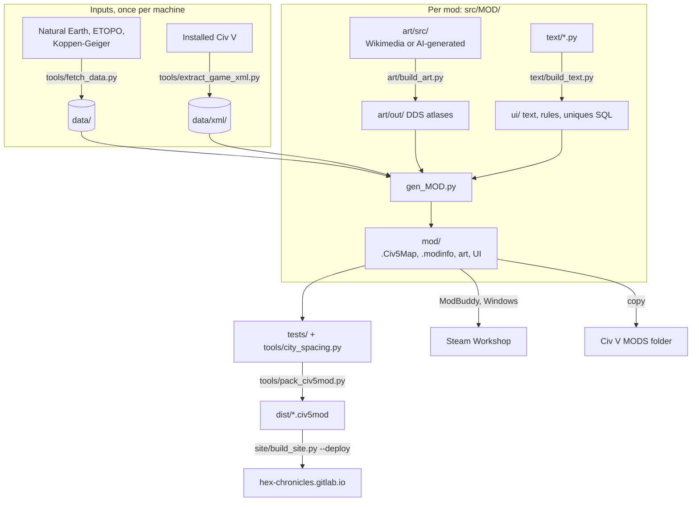

# Hex Chronicles: Civilization V scenario mods

Scenario mods for Civilization V (Brave New World), built by one shared Python pipeline from real geographic data (Natural Earth,
NOAA ETOPO relief, Koppen-Geiger climate), hand-tuned orders of battle, dated events and English + Russian text.

**Download:** [hex-chronicles.gitlab.io](https://hex-chronicles.gitlab.io/)

## Mods

Each mod's README covers its sides, map, events and build details.

| Mod | Start | One turn | Status |
|---|---|---|---|
| [Spain 1936](src/spain-1936/) | 25 July 1936 | 1 week | released |
| [Russia 1918](src/russia-1918/) | 1 June 1918 | 1 week | released |
| [Arcanum 1885](src/arcanum-1885/) | 1885 (fantasy) | 1 year | released |
| [Hawaii 1778](src/hawaii-1778/) | 1778 | 1 year | released |
| [Canarias 1400](src/canarias-1400/) | 1400 | 1 year | released |
| [China 1928](src/china-1928/) | 10 October 1928 | 1 week | coming soon |

## Pipeline



Order per mod: art, then text, then the generator. Arcanum goes generator, text, `ui/build_policy_screen.py`, `build_mod.py`. Canarias and
Hawaii can first run `art/generate_art.py` (Together AI) and `art/build_art.py pick`.
Everything in `src/*/mod/` is generated and committed complete, so a fresh clone installs without a build. A full rebuild reproduces it
byte for byte.

### Requirements

- Civilization V with Gods & Kings and Brave New World
- Python 3 with numpy and Pillow (SciPy for Arcanum)
- ImageMagick 7 and `sqlite3`

The scripts look for the game in the default macOS Steam location. Otherwise set `CIV5_ASSETS` to the game's `Assets` folder and
`CIV5_MODS` to its `MODS` folder. `HEX_DATA` and `HEX_XML` move `data/` and `data/xml/`. The hex-sampling caches in `data/cache/` are
reset with `RU_NOCACHE`, `ES_NOCACHE` or `CN_NOCACHE`.

### Commands

```
python3 tools/fetch_data.py && python3 tools/extract_game_xml.py   # inputs
python3 -m unittest discover tests                                 # map headers, modinfo MD5s, type lists
python3 tools/city_spacing.py --check                              # cities at least 3 hexes apart
python3 tools/pack_civ5mod.py src/<mod>                            # -> dist/<Mod> (v N).civ5mod
python3 site/build_site.py [--deploy]                              # -> site/out/public, GitLab Pages
```

### Install

Copy `src/<mod>/mod/<Name> (v N)` into `MODS`:
- macOS: `~/Library/Application Support/Sid Meier's Civilization 5/MODS/`
- Windows: `Documents\My Games\Sid Meier's Civilization 5\MODS\`

Enable it in Mods, then start it from the Scenarios button. Enable one scenario at a time.

### Publish

Bump `version` in the modinfo and the `(v N)` folder suffix for each release. The mod id never changes. The per-mod steps and page texts
are in `src/<mod>/publish/PUBLISH.md`. The site's mod list, map regions and Workshop links are in `site/mods.json`.

### Crash lessons

- Set `LoggingEnabled`, `MessageLog` and `ValidateGameDatabase` to 1 in `config.ini`. The logs are then written to `Logs/` next to `MODS`.
- Every new unit needs a `UnitGameplay2DScripts` row, or the game crashes when the unit is selected.
- Keep maps at most 160 hexes wide. A 196 x 101 map crashed the game at start.
- To remove techs, set the `Disable` column. Deleting rows breaks references.

## License

MIT (`LICENSE`) for the scripts, text, data files and generated maps. These are not covered:
- the Firaxis files in `src/arcanum-1885/steampunk_src/`
- the Wikimedia art in `art/src/` (see each `CREDITS.txt`)
- the FLUX-generated art of Canarias and Hawaii
- the downloaded inputs in `data/`
