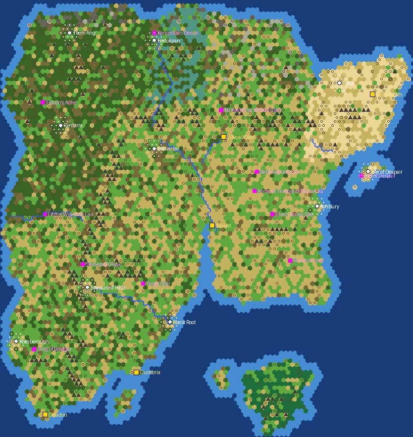

# Arcanum 1885

*Generator preview: the continent of Arcanum from the fan map, with mountain chains, forests, swamps and rivers; coloured dots are the five
starting points, white dots the free cities, stars the natural wonders.*

A long game rather than a war scenario. The units, buildings, policies and tech tree of Firaxis' steampunk scenario
**Empires of the Smoky Skies** (Gods & Kings) run on a 92 x 112 hex map of Arcanum, the continent of *Arcanum: Of
Steamworks and Magick Obscura*. Year 1885 of the Arcanum calendar, **one turn = one year**, Huge map, no turn limit. The intended pace is Epic; the current build runs on
Quick speed for testing (`SPEED` in the generator and the load screen).

## Setup

| | |
|---|---|
| Nations | Tarant (England), Caladon (France), Cumbria (Russia), Wheel Clan (Germany), Vendigroth (Sweden): each starts with one Settler, one Great War Infantry and one Worker at its lore capital, Industrial techs known |
| Free cities (city-states) | Qintarra (cultured), Ashbury (mercantile), Black Root (maritime), Stillwater (militaristic), Shrouded Hills (mercantile), Roseborough (cultured), Tulla (cultured), Isle of Despair (militaristic), Bedokaan (maritime), T'sen-Ang (militaristic); pop 3, Monument and Walls, a guard and a worker |
| Natural wonders | 12 at lore sites, renamed: Bellerogrim's Lair, Ancient Temple of Derian-Ka, Elven Burial Site, Ruins of Kree, Rock of Despair, Ring of Brodgar, Falcon's Ache, Bangellian Deeps, Lethe Wyvern's Lair, Stonewall Peak, Mines of the Wheel Clan, Torg's Altar |
| Resources | randomised by the game each start (map flag), so every game plays differently, then topped up once on turn 1 by `Arcanum1885_Setup.lua` with the game's random generator: every strategic deposit doubled, each strategic resource brought to at least twice the game's count and to a density set by the land (iron 1 per 90 land plots, coal and horses 1 per 110, oil 1 per 160, Aetherium and Luboric 1 per 200), spread over the map by land share; every nation's start gets at least 2 iron, 2 coal and 1 horses within 5 hexes, every free city a strategic deposit within 3; luxury and bonus resources half as many again. Only on plots where the game's own rules allow the resource, never on cities, starts, improvements or natural wonders; the counts go to `Lua.log` |
| Options | Raging Barbarians, no goody huts, no religion, policy saving, happiness on |
| Victories | domination, cultural (tourism), diplomatic (World Congress, United Nations at the second steampunk era); science victory off, the scenario's token victory and turn counter removed |

## What comes from Smoky Skies and what changed

Copied from the game's `DLC/Expansion/Scenarios/SteampunkScenario`: the scenario text, the five re-skinned civilizations with
their leader scenes and traits, the pruned tech tree with 23 steampunk techs and 6 air and land units, and the five-branch policy tree.
Left out: the load screen, turn counter, token victory screens and the Gods & Kings versions of the Civilopedia, tech tree helpers and
Social Policy screen (the Brave New World ones are used instead).

The Firaxis scenario is a Gods & Kings scenario that blocks every other DLC, so three of its files are patched when `build_mod.py` copies them:
- `PolicyUpdate.xml` deleted Freedom, Order and Autocracy, which were ordinary branches in G&K. Under Brave New World they are the
  ideologies the engine insists on once a player is in the Modern era (the first turn here), so they stay, with their tenets. Three tenet
  names the scenario reuses for its own policies (Nationalism, Militarism, United Front) are left to the scenario.
- `RemoveModernEras.xml` deleted the National Epic and Heroic Epic; BNW's Culture Overview screen dies without them.
- The policy screen is rebuilt by `ui/build_policy_screen.py` from BNW's own `SocialPolicyPopup`: its tabs, ideology pane and tenet
  picker, with the five scenario branches in place of the nine stock ones. The scenario's G&K screen also crashed on branches that
  were not yet unlocked.
- The Aesthetics and Exploration branches (BNW additions the scenario never knew about) are removed before the scenario's policy tree
  loads, the Internet tech is removed before the tech tree loads, and branch and policy IDs are renumbered afterwards to stay contiguous.
- `Arcanum1885_Setup.lua` opens all five branches for every nation on turn 1, as the scenario's own script did. It runs once per
  game: only on the first turn, and not again once its save-data flag is set or the branches are open, so reloading a save never adds resources twice.

Arcanum additions, applied after the Firaxis files:
- nation names, leaders, adjectives, Dawn of Man texts and ten city names each (English and Russian);
- ten free cities as new `MINOR_CIV_ARC_*` city-states with traits;
- nation colours;
- the Hotel, Airport, National Visitor Centre and Stadium are rescued from the tech pruning and moved onto steampunk techs (Economic
  Imperialism, Airships, Gospel of Wealth, Civil Defense); the tourism doubling of the removed Internet tech moves to The Grand Idea.
  Without this the cultural victory would depend on Great Works alone;
- calendar: Epic and Quick speed advance one year per turn from 1885.

## Files

- `gen_arcanum1885.py`: parses `art/arcanum_map_source.png` (land, mountains, hand-drawn biome polygons and river polylines), builds the
  92 x 112 map, places starts, free cities and wonders, writes `mod/Arcanum 1885 (v 2)/Arcanum1885.Civ5Map`, `map_layout.json` and the preview.
- `text/build_text.py`: writes `ui/Arcanum1885_Text.xml` (EN + RU), `ui/Arcanum1885_Rules.xml` and `ui/Arcanum1885_PreTech.xml`.
- `build_mod.py`: copies the Smoky Skies files from `steampunk_src/` (patching three of them, see above), the load screen, setup addin,
  policy screen and rules, writes the `.modinfo` and installs the mod into the Civilization V `MODS` folder (`--no-install` skips that).
- `ui/build_policy_screen.py`: generates `ui/SocialPolicyPopup.lua/.xml` from the game's Brave New World files.
- `ui/Arcanum1885LoadScreen.lua/.xml`: scenario entry point with nation and difficulty choice.

Rebuild: `python3 gen_arcanum1885.py && python3 text/build_text.py && python3 ui/build_policy_screen.py && python3 build_mod.py`. In game: Mods, enable Arcanum 1885,
Single Player, Scenarios.

## Credits

Firaxis Games for Empires of the Smoky Skies; Troika Games for Arcanum; the fan map author listed in `art/CREDITS.txt`.
