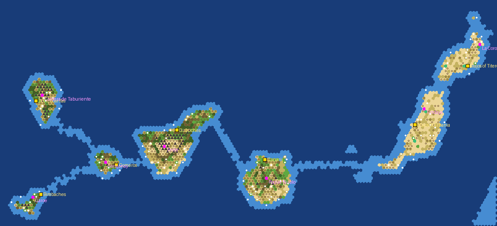
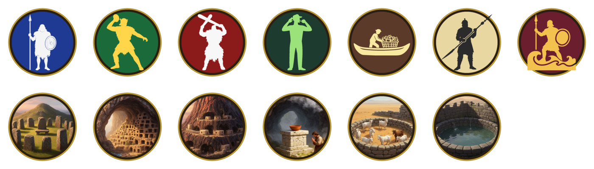
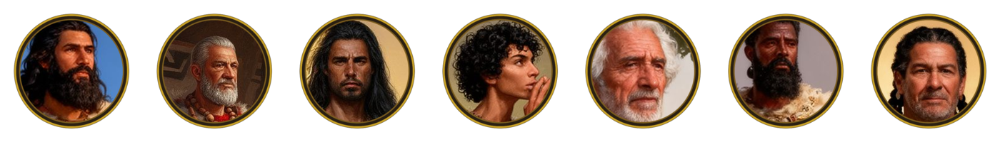
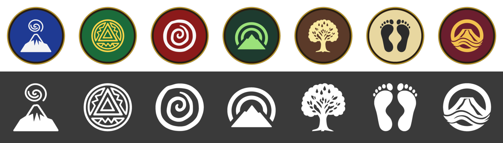

# Canarias 1400

The Canary Islands before the Castilian conquest, as a Civilization V (Brave New World) scenario. Seven islands, seven native
peoples, each starting from a Settler and a Warrior (its own warrior where the Warrior is replaced) in the Ancient era at its historical seat of power. Stock rules, normal
barbarians, Standard speed, **one turn = one year from 1400**, development capped at the Classical era, domination victory only. No events and no armies: one generator, one text file, one SQL file, one load screen, and art generated with FLUX.

*Generator preview: gold squares are the starting positions, magenta squares the natural wonders, white dots resources,
light blue the coast and the shallow sills between islands.*

## Peoples

Each people is a stock civilization renamed, with its unique ability kept and re-described and its own unique unit and building.

| Island | People, leader | Donor civ | Ability as flavoured |
|---|---|---|---|
| Tenerife (Achinet) | Guanches, Bencomo | Shoshone | Spirit of Achinet: bigger starting territory, +15% combat at home |
| Gran Canaria (Tamaran) | Canarii, Tenesor Semidan | Egypt | Granaries of Valeron: +20% wonder production |
| La Palma (Benahoare) | Benahoaritas, Tanausu | Ethiopia | Lords of the Caldera: +20% combat against bigger civilizations |
| La Gomera | Gomeros, Hautacuperche | Inca | Paths of the Whistlers: hills cost no movement, cheap improvements |
| El Hierro (Esero) | Bimbaches, Armiche | Celts | Water of the Garoe: faith from unimproved forest |
| Fuerteventura (Erbania) | Majos of Erbania, Guize | Morocco | Walls of Erbania: gold and culture from trade routes |
| Lanzarote (Titerogaka) | Majos of Titerogaka, Guadarfia | Carthage | Harbours of the Majos: free harbour in every coastal city |

The leaders are the names of the conquest era (1402-1496), used a century early as the faces of their peoples; the
civilopedia entries say who they were. City lists use the native cantons, menceyatos and toponyms. The leaders have their own
portraits, diplomacy scenes, Dawn of Man images and emblems (see Art).

### Unique units and buildings

The donors' own unique units and buildings are unhooked and replaced by Ancient-era ones of the islands. They are SQL clones of the
stock Spearman, Archer, Warrior, Scout, Work Boat, Monument, Granary, Walls, Shrine, Circus and Water Mill (3D models, techs and
upgrade paths stay), with their own stats, promotions, icons and civilopedia text (`text/uniques.py`, `ui/Canarias1400_Uniques.sql`).

| People | Unit | Building |
|---|---|---|
| Guanches | **Sigone** (Spearman): 12 strength, Drill I (+15% in rough terrain) | **Tagoror** (Monument): +1 happiness, no maintenance |
| Canarii | **Tirador** (Archer): 6 / 8 strength for the same cost | **Cenobio** (Granary): +3 food, +1 food from Sheep too |
| Benahoaritas | **Magado** (Warrior): 9 strength, Cover I (+25% vs ranged) | **Cuevas** (Walls): +8 defence, +75 HP, no maintenance |
| Gomeros | **Silbador** (Scout): 6 strength, Sentry (+1 sight) | **Bancales**: the Terrace Farm improvement |
| Bimbaches | **Mariscador** (Work Boat): 25 production, 5 moves | **Aranfaybo** (Shrine): +2 faith, +1 food |
| Majos of Erbania | **Ahepa** (Spearman): 42 production, Shock I (+15% in open terrain) | **Gambuesa** (Circus): no horses or ivory needed, +1 production from Sheep |
| Majos of Titerogaka | **Guard of Zonzamas** (Warrior): Amphibious (no penalty attacking from the sea) | **Mareta** (Water Mill): no river needed, 1 gold maintenance |

#### Religion

The thirteen stock religions are the cults of the islands' gods, with their own symbols: Achaman, Magec, Chaxiraxi, Achuguayo,
Achuhucanac, Acoran, Alcorac, Abora, Orahan, Eraoranhan, Moneiba, Chijoraji, Guayota (thirteen with the two Reformation
religions). Names and the large icons are replaced; the small inline symbol
in text comes from the game's font and stays.

## Development cap

Research stops at the end of the Classical era: the Medieval and later technologies stay in the tree but cannot be researched
(`Disable` flag), with one exception, Guilds, for trading posts. No Astronomy means no caravels and no ocean crossing, so the war between the islands is fought by embarked
Classical armies (spearmen, swordsmen, composite bowmen, catapults) and triremes; no Printing Press means no World Congress, and with no archaeology, hotels or music there is no
tourism to speak of, so the cultural victory is off too. Domination is the only victory; the time victory is not listed, so the
game does not end at the turn limit.
There are no coal, oil, aluminium or uranium deposits on the map, and no horses.

## Social policies

The nine stock policy branches are replaced by the three of Firaxis' Paradise Found scenario, with the same effects and icons
(`tools/paradise_policies.py`), under Guanche names (the mechanics are the Polynesian scenario's, unchanged); the three ideologies stay but
are unreachable. The stock policy screen expects the nine stock branches, so the mod carries its own
(`ui/SocialPolicyPopup.lua/.xml`, built from the game's file by `tools/build_policy_screen.py`), with the Paradise Found branch
panels from the Polynesia DLC and the stock Piety and Commerce panels.

| Branch | Policies |
|---|---|
| **Beñesmen** (−33% unhappiness from population in the capital) | Guañameñe: policies 10% cheaper. Tagoror: gold gifts to city-states give 25% more influence. Lucha: +1 happiness per city. Gofio: +10 happiness. Guatatiboa: +2 happiness per luxury type. |
| **Pintaderas** (+2 culture from Monuments and Temples) | Tajaraste: golden ages need 25% less happiness. Harimaguadas: +100% science from Libraries and Observatories. Tamarco: +2 culture per city. Petroglyphs: +1 culture from Moai. Tara: half of the excess happiness becomes culture. |
| **Guayres** (+15 XP for new land units) | Mariscadores: +1 movement embarked. Menceyes: Great Generals appear twice as fast. Guatimac: Great People appear twice as fast. Tabona: melee units get Medic. Magado: triple culture from kills. |

Two of them do nothing here: Tagoror (there are no city-states on the map) and Petroglyphs (only Polynesia builds Moai).

## Map

160 x 83 hexes, 3 km per hex, real geography: land, relief and bathymetry all come from the NOAA ETOPO 2022 relief model at
15 arc-seconds, nothing is moved or shrunk. Island sizes in hexes: Tenerife 261, Fuerteventura 213, Gran Canaria 201, Lanzarote 110,
La Palma 92, La Gomera 46, El Hierro 32, plus La Graciosa and Lobos. The hex size is the `CA_HEX_KM` environment variable (default 3.06);
a 2.5 km version with 196 x 101 hexes crashed the game at the start of the game, 160 wide runs (see the pipeline notes in the root README). Terrain follows altitude and exposure: desert and plains
on the arid eastern islands and the southern slopes, grass and laurel forest on the trade-wind slopes of the western islands, pine
forest above 900 m, lava desert above 2000 m, mountains on the peaks and in the deepest ravines. There are no rivers.

One natural wonder per island at its real site: Teide (Mt. Fuji), Roque Nublo (Mt. Kailash), Caldera de Taburiente (Grand Mesa),
Garajonay (Sri Pada), Garoe (Fountain of Youth), Tindaya (Uluru), La Corona (Krakatoa).

Resources are placed by the generator and balanced per island: every island has iron, the big islands more. There are no horses, and
no mounted units: the islands had none, so every mounted unit, every unit that needs Horses and the Stable are moved to an
unresearchable technology, which keeps them from the barbarians too. Luxuries follow the islands' real exports (orchil dye and salt in the
east, wine and spices in the west), food is goats (sheep), barley (wheat) and fish. Ancient ruins are placed by the generator too.

**Contact.** The peoples had no boats, and the scenario keeps that: everybody builds their island first. The real channels are
deep ocean, which would delay all contact until Astronomy, so the generator lays a shallow sill (coast tiles) along the shortest
crossing between neighbouring islands: Optics lets embarked units cross from the Classical era on. Set `CROSSINGS = []` in the
generator for the strictly bathymetric version.

## Art

Every people has a static diplomacy scene, a round portrait, a Dawn of Man image, an emblem (coloured disc for the
diplomacy screens, white glyph for unit flags and borders), a unit icon and a building icon, all generated with Black Forest Labs' FLUX.2-dev through the
Together AI image API by `art/generate_art.py` (prompts in the script: goat-skin tamarco cloaks, the real landscape of each
island, flat emblems after pintadera stamps, spirals and the Tindaya footprints). The portrait and the Dawn of Man image are cut from the scene, so the face is the same on every screen. The script writes every variant to
`art/gen/` (not committed) with contact sheets; `art/build_art.py pick` copies the variants chosen in its `SELECT` table to
`art/src/`, and `art/build_art.py` turns them into the DDS atlases and scenes in `art/out/` with ImageMagick, keeping the
processed pieces (faces, emblem discs and glyphs, scenes, Dawn of Man images) in `art/cut/`. Both `art/src/` and `art/cut/` are committed.
The generator wires the art in when `art/out/` exists. API key: `TOGETHER_API_KEY` or `~/.together_api_key`.

## Installing

Copy `mod/Canarias 1400 (v 1)` to the Civilization V `MODS` folder, enable it in the Mods menu and start it from the
scenario button: choose an island and a difficulty.

## Files

- `gen_canarias1400.py`: map, starts, wonders, resources, scenario header and `.modinfo`. Input: `data/etopo_ca.tif` from `tools/fetch_data.py` (repository root).
- `text/build_text.py`, `text/ru.py`, `text/uniques.py`: EN + RU text (peoples, leaders, abilities, Dawn of Man, civilopedia, dialogue, cities,
  wonders, unique units and buildings), the database rows (city lists, colours, calendar, tech cap), the SQL for the uniques and for the policy tree (`ui/Canarias1400_Policies.sql`) and the policy screen (`ui/SocialPolicyPopup.lua/.xml`).
- `ui/Canarias1400LoadScreen.lua/.xml`: scenario entry with island and difficulty choice.
- `art/generate_art.py`, `art/build_art.py`, `art/src/`, `art/cut/`: generated leader art, its build and the processed pieces.

Rebuild: `python3 art/build_art.py && python3 text/build_text.py && python3 gen_canarias1400.py`.
