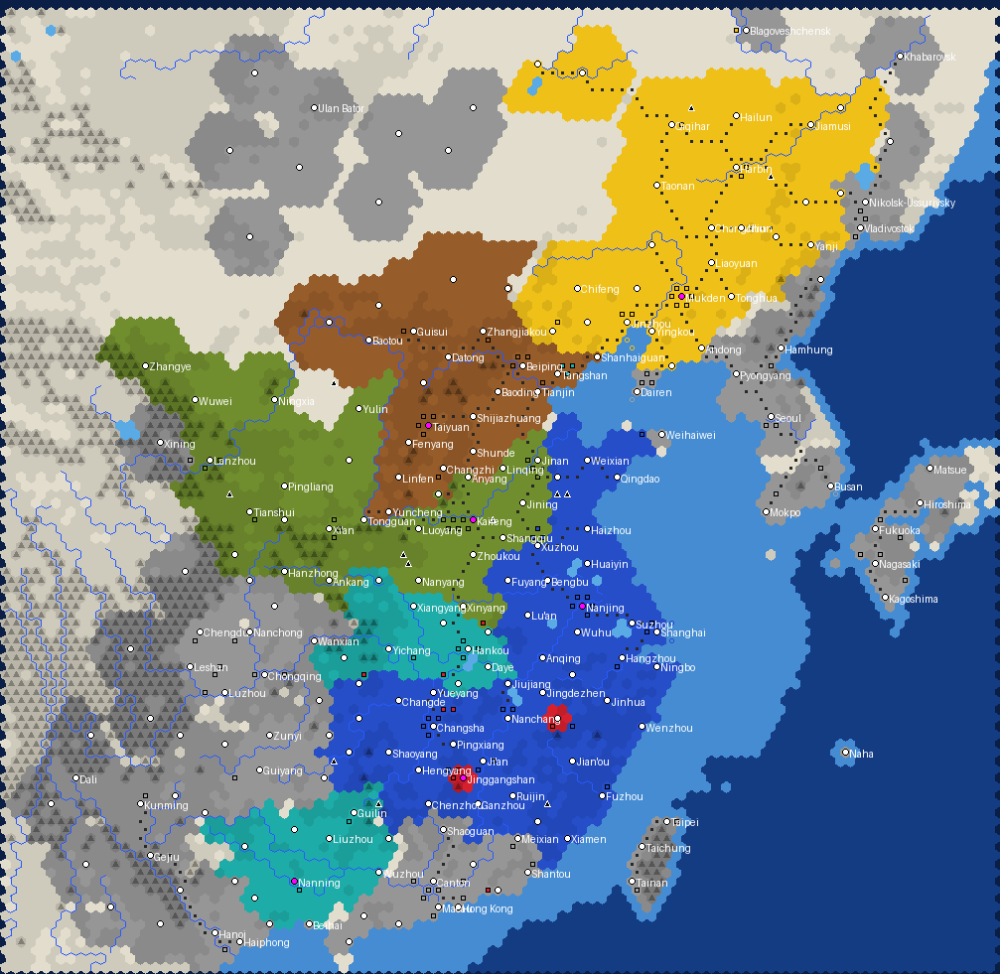

# China 1928

*Generator preview, land filled in its holder's colour: Nanjing blue, Guominjun olive, Shanxi brown, Fengtian yellow, Guangxi teal, Communists red, city-states grey, nobody's land pale;
black triangles are bandit (barbarian) units, white dots cities, magenta dots capitals, dark dots railways.*

China in the warlord era from **10 October 1928**, the day Chiang Kai-shek took office as Chairman of the National
Government after the Northern Expedition, **one turn = one week**, Quick speed, on a 100 x 112 hex map (about 36 km per hex) from Yunnan and Gansu
to the Ussuri and from the Amur to Tonkin, with Korea, Taiwan and western Kyushu. Domination victory only, no turn limit and no scripted victory conditions;
the dated events run to the Marco Polo Bridge on 7 July 1937 (week 456), and the game goes on after them.

## Sides

| Side | Donor civ | Why | Capital | At start |
|---|---|---|---|---|
| National Government (Chiang Kai-shek) | China | Great Generals 50% faster and 15% stronger: the Whampoa officers | Nanjing | Jiangsu, Zhejiang, Anhui, Jiangxi, Fujian, Hunan (Lu Diping), eastern Shandong with Qingdao; the Central Army, gunboats, a few aircraft |
| Guominjun (Feng Yuxiang) | Zulu | cheap melee units, faster promotions: the drilled Northwest Army | Kaifeng | Henan, Shaanxi, Gansu, Ningxia and Alashan, western Shandong (Sun Liangcheng) with Jinan |
| Shanxi (Yan Xishan) | Russia | +1 production from strategic resources, double iron and horses: Shanxi's coal and arsenal | Taiyuan | Shanxi, Hebei with Beiping and Tianjin, Chahar, Suiyuan |
| Fengtian (Zhang Xueliang) | Germany | captured barbarians join, cheaper land units: Zhang Zuolin began as a bandit chief | Mukden | Liaoning, Jilin, Heilongjiang with the Barga, Rehe and the eastern Mongol leagues; the Mukden Arsenal, an air force, tanks, a navy |
| Guangxi (Li Zongren) | Ethiopia | +20% against larger sides | Nanning | Guangxi, and Hubei with Wuhan under the Wuhan Political Council; Bai Chongxi's troops at Tangshan in Hebei |
| Chinese Communists (Mao Zedong) | Shoshone | +15% in own territory, forest in own territory moves like a road (the founded-city territory of the stock ability is dead here and replaced) | Jinggangshan | Jinggangshan on the Hunan-Jiangxi border and Fang Zhimin's base at Hengfeng; guerrillas around the Hong Lake, in the Dabie mountains, in western Hunan, at Pingjiang and Hailufeng |

Unique units and buildings (`text/uniques.py`, cloned from the stock rows by `ui/China1928_Uniques.sql`; the donors' own uniques are unhooked, and the
event units stay the stock types the events name):

| Side | Unit | Building |
|---|---|---|
| National Government | Central Army Division (Great War Infantry, 55 strength, Shock I, 360 production) | Central Military Academy (Military Academy, 200 production, no upkeep) |
| Guominjun | Big Sword Brigade (Great War Infantry, 48 strength, Shock I + March, 270 production) | Military Farm Colony (Granary, +1 production, no upkeep) |
| Shanxi | Taiyuan Mountain Gun (Artillery, 24 strength, 200 production) | Northwest Industrial Company (Workshop, +3 production, upkeep 1) |
| Fengtian | Breguet 19 (Great War Bomber, 55 ranged strength, 300 production) | Mukden Arsenal (Factory, +5 production, upkeep 2) |
| Guangxi | Guangxi Division (Great War Infantry, 52 strength, Drill I + Drill II) | Militia Training Office (Barracks, +20 land XP, no upkeep) |
| Chinese Communists | Red Army Column (Great War Infantry, 44 strength, Drill I + March, 220 production) | Land Revolution Committee (Monument, +1 food, +1 production, no upkeep) |

City-states (13): Japan (Dairen with Port Arthur, Korea, Taiwan, Okinawa, Kyushu and western Honshu), the Soviet Union (Vladivostok, Khabarovsk, Blagoveshchensk),
the Mongolian People's Republic, Sichuan (Liu Wenhui at Chengdu), Chongqing (Liu Xiang), Yunnan (Long Yun), Guizhou (Zhou Xicheng), Guangdong (Canton),
Qinghai (the Ma clique at Xining), Hong Kong, Macau, Weihaiwei, and French Indochina (Tonkin, northern Laos and Guangzhouwan). Bandits, the Red Spears and
the honghuzi are raging barbarians; land more than five hexes from a city belongs to nobody and breeds them.

Relations: the five armies of the National Revolutionary Army start at peace with open borders and no friendships; nothing is locked, so the
Chiang-Guangxi war, the Central Plains War and their sequels come by event or by choice. All five are at war with the Communists, also unlocked: the Xi'an
incident ends that war. `GAMEOPTION_COMPLETE_KILLS` is on: a side that loses its last city lives on while it has units, so the Red Army can lose its bases
and march.

## Rules

- Techs through the Industrial era plus Flight, Combustion, Replaceable Parts, Railroad, Refrigeration and Ballistics; research is off. Units: Great War
  Infantry, Riflemen, Lancers and Cavalry, Artillery, Machine Guns, Triplanes and WWI bombers, a few WWI tanks, gunboats, cruisers and destroyers.
- No world wonders, no religion, no happiness, no leagues, raging barbarians, policy saving on. Chinese sides, Japan and the provincial city-states use
  Asian city art; the Soviet Union and the colonies European.
- 207 cities sized from populations around 1928-1931: the 340 towns of the list are thinned so that no two cities stand closer than three hexes, whoever
  holds them, and two cities of one side no closer than four unless both are capitals or event towns. Where towns collide the more important one stays
  (a capital, then a city-state capital, then an event town, then the bigger town) and the other merges its population into it, so Zhengzhou is part of
  Kaifeng, Changting and Ningdu of Ruijin, Linchuan of Nanchang, Port Arthur of Dairen, Wuxi and Changzhou of Suzhou. The one deliberate
  exception is Macau, two hexes from Hong Kong: both colonies are kept as city-states (`SPACING_EXCEPTIONS` in the generator). The generator
  checks the rule on the final city plots.
  The control lines of October 1928 are drawn from the provinces with overrides (Rehe and the Mongol leagues, Alashan, western Shandong, the Kwantung
  Leased Territory, Weihaiwei, Guangzhouwan, eastern Sichuan, the two Communist bases). The 1928 railway network is drawn line by line: Beiping-Mukden,
  Beiping-Hankou, Tianjin-Pukou, Jiaoji, the Longhai as far as Lingbao (merged into Tongguan on the map), Beiping-Suiyuan, Shanghai-Nanjing and Shanghai-Hangzhou, the two halves of the
  Canton-Hankou line, the Chinese Eastern and South Manchuria railways with the Chinese-built Manchurian lines, the Korean, Taiwanese and Kyushu lines and
  the Yunnan railway. Strategic resources are balanced so that every side can fuel the aircraft and tanks it starts with or receives.
- Weekly events (see `ui/China1928_Events.lua`), 78 dated and 12 recurring: the Chairman's inauguration, the Disbandment Conference, the Northeast Flag
  Replacement and the Yang-Chang incident, the Hunan incident and the Chiang-Guangxi war, the fall of Wuhan, Han Fuju's defection, the northwest famine,
  the Chinese Eastern Railway crisis and the Soviet offensives at Lahasusu and Manzhouli, the Khabarovsk Protocol, the Guominjun's war of 1929, the
  coalition of Yan, Feng and Li, the Central Plains War, the Enlarged Conference in Beiping, the Northeast Army entering the pass (Beiping and Tianjin
  change hands), the rendition of Weihaiwei, the five encirclement campaigns, the 1931 floods, the Canton government and the reunion, the Mukden incident,
  the Korea Army, the Nenjiang Bridge, Jinzhou, Harbin, Manchukuo (Changchun becomes Xinjing), the Shanghai incident and ceasefire, Shanhaiguan, Rehe,
  Zhang Xueliang's resignation and return, the Tanggu Truce, the Chahar Anti-Japanese Allied Army, Yan's return and the Northwest Industrial Company,
  the Fujian People's Government, the New Life Movement, the Three Selfs of Guangxi, the Jinggangshan, Gannan, Changting, Gutian, Changsha, Longgang,
  the Chinese Soviet Republic, the Ningdu uprising, the Long March with the Xiang River, Zunyi, Luding and the arrival in northern Shaanxi (the
  Communists found Wayaobao), the He-Umezu Agreement, East Hebei, the currency reform, the Eastern Expedition, the Liangguang incident (Guangdong passes to
  Nanjing), the Suiyuan campaign and Bailingmiao, the reunion of the Red Armies, the Xi'an incident and the Marco Polo Bridge. Units spawn in the named
  city if the side or a side at peace with it holds it, otherwise in the capital; guerrillas and invaders appear beside the named city whoever holds it, or
  at named spots of the map (the railway zone at Mukden, Wusong, Fengtai, Yudu, Wuqi...). Japan and the Soviet Union act through their city-states.
- The top panel shows the real date and the week number; the engine calendar is parked.

## Files

- `gen_china1928.py`: map, scenario and mod wrapper (regions from Natural Earth admin-1 mapped to the October 1928 holders with polygon overrides, ETOPO
  relief, Koppen climate, natural lakes without the later reservoirs, rivers, cities, railways, units, strategic balance, city-states, the event spots
  written into the copied events Lua, `.modinfo`). Hex sampling is cached in `data/cache/`; set `CN_NOCACHE=1` to redo it.
- `text/build_text.py`, `text/ru.py`, `text/events_text.py`, `text/uniques.py`: EN + RU text for leaders, dialogue, city-states, events, the calendar
  and the unique units and buildings; `build_text.py` also writes `ui/China1928_Uniques.sql`.
- `art/build_art.py`, `art/src/`: portrait and emblem sources with credits, ImageMagick build (output DDS is not committed; the copies in `mod/` are).
- `ui/China1928LoadScreen.lua/.xml`: scenario entry with side and difficulty choice; `ui/China1928_Production.lua`: the turn-1 swap of the placed stock
  buildings for each side's own, production queues (each side's own unit of the queued class), unit names (bandits for the barbarians), calendar;
  `ui/China1928_Events.lua`: dated events.
- `publish/`: the Workshop cover, the page images (`make_screens.py`) and the publishing guide with the page text.

Rebuild: `python3 art/build_art.py && python3 text/build_text.py && python3 gen_china1928.py`, then copy `mod/China 1928 (v 1)` into the Civilization V `MODS` folder.

## Art

Leader portraits (Chiang Kai-shek, Feng Yuxiang, Yan Xishan, Zhang Xueliang, Li Zongren, Mao Zedong) and side emblems (the Kuomintang's Blue Sky with a
White Sun, the five-coloured Beiyang star the Guominjun used before 1926, the seal of the Shanxi provincial government, the Five Races Under One Union
flag, the national flag, the flag of the Chinese Soviet Republic) come from Wikimedia Commons, all public domain; file names, authors, sources and licences
are in `art/src/CREDITS.txt`. `art/build_art.py` makes the round portraits in Civ-style rings, the emblem discs, the white glyphs, the static diplomacy
scenes and the Dawn of Man images with ImageMagick. The leaders are historical figures; their dialogue is invented.

## Design notes and known simplifications

- 1928 rather than 1927: after the Huanggutun incident (4 June 1928) and the fall of Beijing the Northern Expedition was over, and 10 October 1928, when the
  Organic Law gave Nanjing a government and Chiang its chairmanship, is the first day all six sides stand as they would for the next two years.
- The map stops at about 98.5 degrees east: Xinjiang, Tibet and most of Qinghai lie outside, so Jin Shuren's (from 1933 Sheng Shicai's) Xinjiang is not a city-state.
  The Ma clique is represented by Qinghai; the Ma of Ningxia were Guominjun allies in 1928 and stand under Feng.
- Japan is a city-state rather than a player, as the brief asks: the Kwantung Army, the Korea Army and the fleet act through events (wars, landings, the
  Manchukuo renaming) and a recurring reinforcement. It holds Korea, Taiwan and the parts of Kyushu and Honshu the map covers, so the corner of the map is
  not empty. The South Manchuria Railway zone is not a separate territory; the Mukden incident spawns the Kwantung Army along the line.
- The Shanghai International Settlement and the Tianjin concessions are too small for 36 km hexes and are not city-states; Shanghai is Nanjing's.
- In October 1928 Jinan was still under Japanese occupation (until May 1929); it is a Guominjun city here, the seat of Sun Liangcheng's Shandong government.
- Guangdong under Li Jishen and then Chen Jitang was a separate power from Nanjing and Guangxi; it is a city-state until the Liangguang incident of 1936,
  when the event hands its cities to Nanjing. Weihaiwei passes to Nanjing on 1 October 1930.
- The Communists' capital is Jinggangshan (Ciping); Ruijin is a Nanjing town until the Red Army takes it. The Long March cannot be scripted step by step:
  the event gives the Central Red Army units at Yudu and later in northern Shaanxi, where the Communists found Wayaobao if the land is free, and the
  complete-kills option keeps the side alive between its bases.
- The Northeast Army entering the pass in 1930 hands Beiping and Tianjin to Fengtian only if Shanxi still holds them; the Fujian rebels of 1933 are
  barbarians, as the 19th Route Army fought Nanjing and was not allied with any side.
- Event texts are neutral and state what the event changes in the game. Famine, floods and the violence of the period against civilians are
  described where the events name them but are not turned into game mechanics beyond gold.
