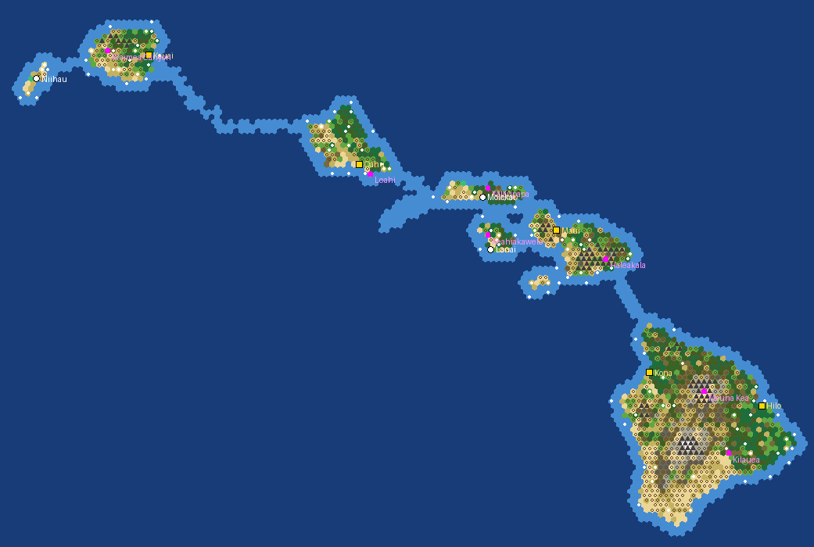
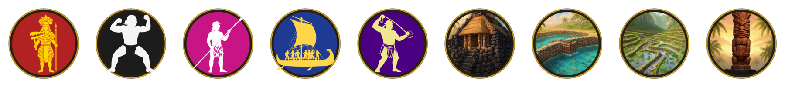
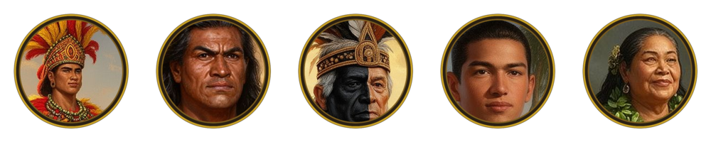
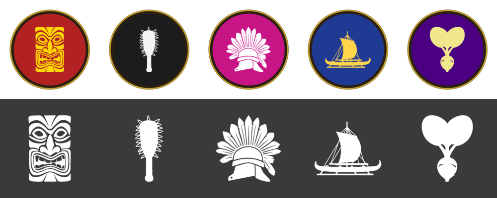

# Hawaii 1778

The Hawaiian Islands on the eve of contact, as a Civilization V (Brave New World) scenario built with the Canarias 1400 pipeline.
Five chiefdoms start from a Settler and a Warrior (the Koa for Kona) in the Ancient era at their historical seats, from scratch: canoes
and crossings come with Sailing and Optics. Three lesser islands are city-states. Stock
rules, normal barbarians, Standard speed, **one turn = one year from 1778**, development capped at the Classical era (plus Guilds, for trading posts), the Paradise Found policy tree, domination
victory only (no tourism to speak of before the Renaissance, so no cultural victory; no time victory, so the game does not end at the turn limit). No iron
and no horses: the islands had neither.

*Generator preview: gold squares are the starting positions, white circles the city-states, magenta squares the natural wonders,
white dots resources, light blue the coast and the sills between islands.*

## Chiefdoms

| Island | Chiefdom, leader | Donor civ | Ability as flavoured |
|---|---|---|---|
| Hawaii, Kona and Kohala | Kona, Kamehameha | Polynesia | Voyagers of the Long Canoe: cross ocean from the start, +10% combat near Kii |
| Hawaii, Hilo, Puna and Kau | Hilo, Keoua Kuahuula | Japan | Warriors of the Lua: full strength when damaged, culture from fishing boats |
| Maui with Lanai and Kahoolawe | Maui, Kahekili | Zulu | The Tattooed King: cheap melee upkeep, faster promotions |
| Oahu | Oahu, Kahahana | Carthage | Bays of the Gathering Place: free harbour in every coastal city |
| Kauai with Niihau | Kauai, Kamakahelei | Ethiopia | The Unconquered Island: +20% combat against bigger civilizations |
| Molokai, Lanai, Niihau | city-states | | religious, maritime, maritime |

The Big Island is split as it was in 1782: Kamehameha's west against his cousin Keoua's east. Kamakahelei was the ruling chiefess
of Kauai when Cook anchored at Waimea in January 1778. City lists use the ahupuaa and districts of each island.

### Unique units and buildings

| Chiefdom | Unit | Building |
|---|---|---|
| Kona | **Koa**: the Polynesian Maori Warrior under its Hawaiian name and icon | **Kii**: the Moai improvement under its Hawaiian name and icon |
| Hilo | **Olohe** (Swordsman): 13 strength, needs no iron | **Puuhonua** (Shrine): +1 happiness |
| Maui | **Pololu** (Spearman): 12 strength, Shock I (+15% in open terrain) | **Halau**: the Zulu Ikanda under its Hawaiian name |
| Oahu | **Peleleu**: the Carthaginian Quinquereme as the war canoe, with its own icon | **Loko Ia** (Lighthouse): no maintenance, +1 food from Fish |
| Kauai | **Maa Slinger** (Archer): 30 production, withdraws from melee | **Loi Kalo** (Granary): +3 food, +1 food from Sugar |

The Olohe, Pololu, Maa, Puuhonua, Loko Ia and Loi Kalo are SQL clones of stock rows (`text/uniques.py`, `ui/Hawaii1778_Uniques.sql`); the
other four are the donors' own uniques renamed. Japan's, Zulu's and Ethiopia's uniques are unhooked. Since there is no iron on the map,
the Olohe is the only Swordsman anyone can build.

### Religion

The thirteen stock religions are the cults of the Hawaiian gods, with their own symbols: Kane, Ku, Lono, Kanaloa, Pele, Hina, Laka,
Haumea, Papa, Kamapuaa, Kukailimoku, Kuula, Kamohoalii (thirteen with the two Reformation religions). Names and the large icons are replaced; the small inline symbol in text comes from the game's
font and stays.

## Social policies

The nine stock policy branches are replaced by the three of Firaxis' Paradise Found scenario, with the same effects and icons
(`tools/paradise_policies.py`), under their Hawaiian names; the three ideologies stay but
are unreachable. The stock policy screen expects the nine stock branches, so the mod carries its own
(`ui/SocialPolicyPopup.lua/.xml`, built from the game's file by `tools/build_policy_screen.py`), with the Paradise Found branch
panels from the Polynesia DLC and the stock Piety and Commerce panels.

| Branch | Policies |
|---|---|
| **Ceremony** (−33% unhappiness from population in the capital) | Kapu: policies 10% cheaper. Hookupu: gold gifts to city-states give 25% more influence. Heenalu: +1 happiness per city. Awa: +10 happiness. Luau: +2 happiness per luxury type. |
| **The Arts** (+2 culture from Monuments and Temples) | Hula: golden ages need 25% less happiness. Oli: +100% science from Libraries and Observatories. Kapa: +2 culture per city. Pohaku: +1 culture from Moai. Kii: half of the excess happiness becomes culture. |
| **Honor** (+15 XP for new land units) | Poi: +1 movement embarked. Alii: Great Generals appear twice as fast. Mana: Great People appear twice as fast. Kahuna Healing: melee units get Medic. Haa: triple culture from kills. |

## Map

148 x 114 hexes, 4 km per hex (`HI_HEX_KM`), real geography from the NOAA ETOPO 2022 relief model at 15 arc-seconds. Island sizes in
hexes: Hawaii 747, Maui 135, Oahu 116, Kauai 107, Molokai 52, Lanai 28, Niihau 13, Kahoolawe 7. The climate follows the trade winds:
rainforest (jungle) on the windward lowlands, koa and ohia forest on the uplands, dry plains and desert on the leeward coasts of Kona,
Kihei and Ewa, the lava fields of Kau and Puna as desert, tundra above 2600 m and snow on Mauna Kea and Mauna Loa.

One natural wonder per island, two on the Big Island: Mauna Kea (Mt. Kilimanjaro), Kilauea (Krakatoa), Haleakala (Barringer Crater),
Leahi (Rock of Gibraltar), Waimea Canyon (Grand Mesa), Kalaupapa (Mt. Kailash), Keahiakawelo (Uluru).

Resources are placed by the generator: taro and breadfruit (Bananas), sweet potato (Wheat), pigs and fowl (Deer), stone, fish, whales,
pearls and crabs; sandalwood (Incense), salt, olena (Dye) and sugarcane as luxuries. Ancient ruins are placed by the generator.

**Crossings.** Shallow sills (coast tiles) run along the shortest crossing between every pair of neighbouring islands, including the
long Kauai channel, so embarked units and canoes can cross once Optics is known; the real channels are deep ocean, which would need the
disabled Astronomy. Set `CROSSINGS = []` in the generator for the strictly bathymetric version.

## Art

Scenes, emblems and icons generated with FLUX.2-dev through the Together AI image API (`art/generate_art.py`), chosen variants in
`art/src/`, built with ImageMagick by `art/build_art.py` (portraits and Dawn of Man images are cut from the scenes), processed pieces
in `art/cut/`.

## Installing

Copy `mod/Hawaii 1778 (v 1)` to the Civilization V `MODS` folder, enable it in the Mods menu and start it from the scenario
button: choose a chiefdom and a difficulty.

## Files

- `gen_hawaii1778.py`: map, starts, city-states, wonders, resources, ruins, scenario header and `.modinfo`. Input: `data/etopo_hi.tif` from `tools/fetch_data.py`.
- `text/build_text.py`, `text/ru.py`, `text/uniques.py`: EN + RU text and the database rows (city lists, city-states, colours, calendar, tech cap), the SQL for the uniques and for the policy tree (`ui/Hawaii1778_Policies.sql`) and the policy screen (`ui/SocialPolicyPopup.lua/.xml`).
- `ui/Hawaii1778LoadScreen.lua/.xml`: scenario entry with chiefdom and difficulty choice.
- `art/generate_art.py`, `art/build_art.py`, `art/src/`, `art/cut/`: generated art, its build and the processed pieces.

Rebuild: `python3 art/build_art.py && python3 text/build_text.py && python3 gen_hawaii1778.py`.
