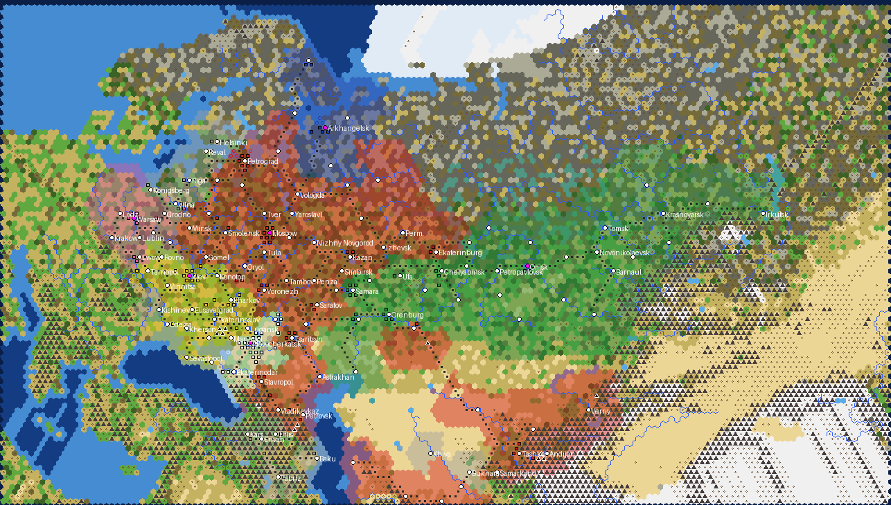

# Russia 1918

*Generator preview: Reds red, White South white, Siberia green, Northern Region blue, Ukraine yellow, Poland purple, city-states grey; black triangles are
insurgent (barbarian) units, white dots cities, magenta dots capitals, dark dots railways.*

First playable build. The Russian Civil War from **1 June 1918**, **one turn = one week**, Quick speed, on a 160 x 104 hex map (about 47 km per hex)
from East Prussia and Finland to Irkutsk and from Murmansk to Transcaspia. Domination victory only, no turn limit and no scripted victory conditions.

## Factions

| Faction | Donor civ | Why | Capital | At start |
|---|---|---|---|---|
| Russian SFSR (Lenin) | Russia | double Horses and Iron, +1 production on strategic resources: the arsenals of the centre | Moscow | central Russia, the Volga, the North Caucasus, Turkestan; the biggest but greenest army |
| White South (Denikin) | Germany | captured barbarians join, cheap land units | Novocherkassk | the Don and the Kuban; few units, all veterans |
| Siberia (Kolchak) | Shoshone | +15% in own territory, forest moves like road there | Omsk | Samara to Irkutsk along the Trans-Siberian, the Orenburg and Ural Cossacks; the Czechoslovak Legion |
| Northern Region (Yudenich) | England | fast navy, city-state influence lasts longer | Arkhangelsk | Murmansk and Arkhangelsk with the Allied landing force (two months early) |
| Ukrainian State (Skoropadsky) | Ethiopia | +20% against larger civs | Kiev | all of Ukraine, the Donbass, Crimea and Belgorod under German garrisons that leave in November |
| Poland (Pilsudski) | Poland | Miracle on the Vistula: Great Generals 50% faster and +15% stronger | Warsaw | Congress Poland, Galicia with Lwow, Grodno and Brest; Wilno is Lithuanian, the first prize |

Abilities whose stock effect is dead in the scenario were replaced in v2 (`text/uniques.py`, `TRAITS`): Siberia's wider borders for founded
cities (nobody founds a city) became movement through friendly forest as along a road; the Northern Region's extra spy (spies come with
era changes, and research is off) became slower decay and faster recovery of city-state influence; Poland's free policy per era (the era
never changes) became Miracle on the Vistula. The Reds' text now says what the stock effect is (double Horses and Iron, +1 production on
strategic resources), not "double strategic resources".

Unique units and buildings (`text/uniques.py`, cloned from the stock rows by `ui/Russia1918_Uniques.sql`; the donors' own uniques are unhooked, and the
event units stay the stock types the events name). Every base unit is buildable with the scenario's techs (Cavalry is obsolete with Combustion,
Riflemen with Replaceable Parts, so neither is a base):

| Side | Unit | Building |
|---|---|---|
| Russian SFSR | Tachanka (Gatling Gun, 3 moves) | Military Commissariat (Barracks, +15% land unit production, no upkeep) |
| White South | Coloured Regiment (Great War Infantry, 54 strength, Shock I, +10% cost) | Cossack Stanitsa (Stable, +15 XP for mounted units, no upkeep) |
| Siberia | Armoured Train (Artillery, 30 strength, 3 moves, +10% cost) | Railway Workshops (Workshop, +3 production, upkeep 1) |
| Northern Region | Mark V Tank (Landship, 65 strength, 3 moves) | Allied Supply Base (Seaport, +2 production, 200 production) |
| Ukrainian State | Serdiuk Division (Great War Infantry, 52 strength, Cover I, 340 production) | Sugar Refinery (Windmill, +2 gold) |
| Poland | Uhlans (Lancer, 32 strength, 200 production) | Officer School (Military Academy, no Armory needed, 200 production, no upkeep) |

The setup script's production queues ask for each side's own unique where it has one of the queued class, and the mounted slot asks for the
Lancer class (stock Cavalry cannot be built after Combustion).

City-states (13): Finland, Estonia, Latvia, Lithuania (Vilna, where the Taryba sat), Germany (Konigsberg), Romania (Kishinev as Bessarabia), Georgia, Azerbaijan, Armenia, the Ottoman Empire
(Kars), Persia (Tabriz), Bukhara and Khiva. Makhno, the Basmachi, Dagestani murids and later Grigoriev's and Antonov's risings are raging barbarians; the
empty steppe and taiga more than seven hexes from a city belong to nobody and breed partisans.

Relations: the RSFSR is at permanent war with the three White governments; the Whites have permanent peace, open borders and a friendship among themselves.
Ukraine and Poland start neutral; events bring the Soviet-Ukrainian war (December 1918) and the Polish-Soviet war (February 1919), and the AI is free to
make its own wars and peace otherwise.

## Rules

- Techs through the Industrial era plus Flight, Combustion, Replaceable Parts, Railroad and Refrigeration; research is off (no new weapons appear by
  science, only by events). Units: Great War Infantry, Riflemen, Cavalry, Artillery, Gatling guns, a few Triplanes and WWI bombers, the Baltic Fleet,
  Caspian and White Sea gunboats; British tanks arrive by event.
- No world wonders, no religion, no happiness, no leagues, raging barbarians, policy saving on.
- About 120 cities with 1917 populations: the full list of 240 towns is thinned so that no two cities stand closer than three hexes and no two of one side closer than four unless both are key towns (capitals, event cities, the towns the history turns on); the more important town is kept and the other merges its population into the nearest kept city of its side (Rostov and Taganrog into Novocherkassk, Novorossiysk into Ekaterinodar, Kovno into Vilna, Mogilev into Smolensk, Bialystok into Grodno; where towns compete, the one that mattered in 1918-1920 wins). The 1918 railway network is drawn line by line, strategic resources balanced so every side can keep its cavalry and
  gunboats supplied.
- Weekly events (see `ui/Russia1918_Events.lua`): compulsory service and the Latvian Riflemen, Trotsky at Sviyazhsk, the First Cavalry Army; the Second
  Kuban campaign, British tanks at Novorossiysk, the Moscow Directive, Mamontov's raid, Wrangel; Komuch, Kolchak's coup, British supplies via
  Vladivostok, the spring offensive; the Allied landing at Arkhangelsk, the Polar Bears, the Northern Corps, the Allied evacuation, Yudenich's march on
  Petrograd; the German withdrawal and the Directory, the Act of Unity, the Warsaw agreement; Polish independence, Bereza Kartuska, Haller's Blue Army,
  the Kiev offensive, the volunteers of 1920; Grigoriev's mutiny and the Tambov rising as barbarian spawns.
- The top panel shows the real date and the week number; the engine calendar is parked.

## Files

- `gen_russia1918.py`: map, scenario and mod wrapper (regions from Natural Earth admin-1 mapped to the June 1918 fronts, ETOPO relief, Koppen climate,
  rivers, cities, railways, units, strategic balance, city-states, `.modinfo`). Hex sampling is cached in `data/cache/`; set `RU_NOCACHE=1` to redo it.
- `text/build_text.py`, `text/ru.py`, `text/events_text.py`, `text/uniques.py`: EN + RU text for leaders, dialogue, city-states, events and the
  unique units and buildings; `build_text.py` also writes `ui/Russia1918_Uniques.sql` (the uniques and the replaced abilities).
- `art/build_art.py`, `art/src/`: portrait and emblem sources with credits, ImageMagick build (output DDS is not committed).
- `ui/Russia1918LoadScreen.lua/.xml`: scenario entry with side and difficulty choice; `ui/Russia1918_Production.lua`: production queues (each side's own unit of the queued class), unit names,
  White friendship, calendar; `ui/Russia1918_Events.lua`: dated events.

Rebuild: `python3 art/build_art.py && python3 text/build_text.py && python3 gen_russia1918.py`, then copy `mod/Russia 1918 (v 3)` into the Civilization V `MODS` folder.

## Art

Leader portraits (Lenin 1920, Denikin 1918, Kolchak 1919, Yudenich, Skoropadsky 1918, Pilsudski) and faction emblems (the 1918 RSFSR seal with a hammer and sickle glyph, the imperial eagle, the Siberian white-green flag, St Andrew's ensign, the Ukrainian State arms, the Polish eagle) come from Wikimedia Commons, all public domain; sources in `art/src/CREDITS.txt`. `art/build_art.py` makes the round portraits in Civ-style rings, the emblem discs, the white glyphs, the static diplomacy scenes and the Dawn of Man images with ImageMagick.

## Known simplifications

Arkhangelsk is Allied from turn 1 (historically 2 August); Minsk and eastern Belarus are Red though German troops held them until December; Komuch and
the Siberian Government are one faction from the start; Bessarabia is the Romanian city-state's territory; East Prussia is a German city-state.
