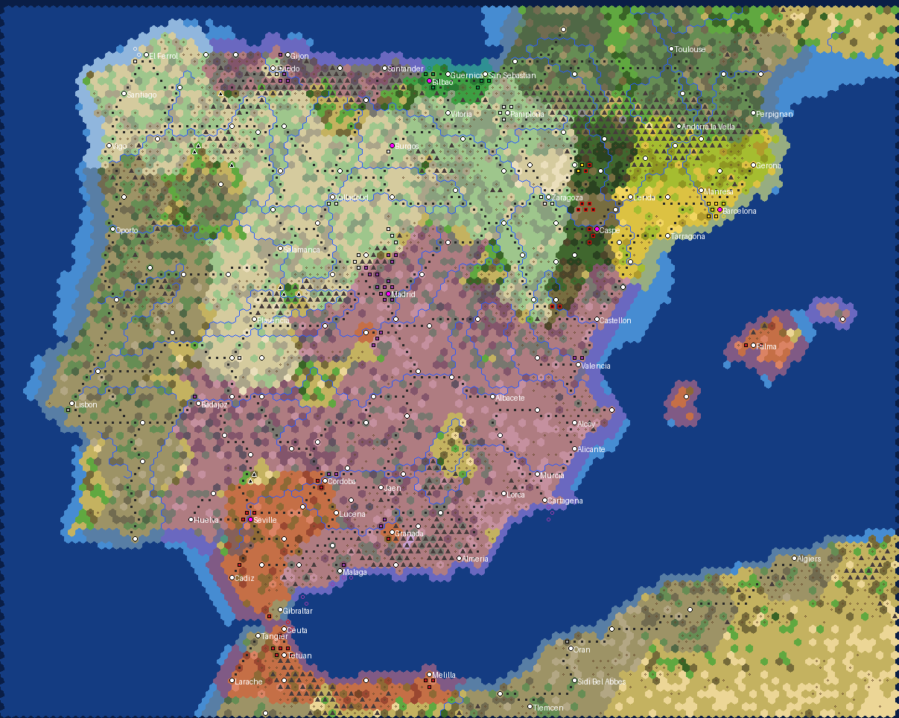

# Spain 1936

*Generator preview: Republic purple, Nationalists red, Army of the North white, Catalonia yellow, Basque Country green, CNT-FAI black, city-states grey;
black triangles are fugitive (barbarian) units, white dots cities, magenta dots capitals, dark dots railways.*

The Spanish Civil War from **25 July 1936**, one week after the rising, **one turn = one week**, Quick speed, on a 120 x 110 hex map
(about 11 km per hex) from Cape Finisterre to Menorca and from the Landes to the Rif. Domination victory only, no turn limit and no scripted victory conditions.

## Sides

| Side | Donor civ | Why | Capital | At start |
|---|---|---|---|---|
| Spanish Republic (Azana) | Russia | +1 production from strategic resources, double iron and horses: the arsenals and the industry | Madrid | New Castile, the Levante, eastern Andalusia, southern Extremadura, Asturias, Santander, Menorca; most of the fleet and the air force, few trained troops |
| Nationalists (Franco) | Zulu | cheap melee units, faster promotions: the Legion and the Regulares | Seville | Seville, Cadiz and Cordoba, the Granada pocket, the Alcazar of Toledo, Mallorca and Ibiza, Spanish Morocco with the Army of Africa |
| Army of the North (Mola) | Germany | cheap land units, captured barbarians join | Burgos | Old Castile and Leon, Galicia, Navarre, Alava, the Rioja, Caceres, western Aragon, Oviedo; the requetes and the Guadarrama columns |
| Catalonia (Companys) | Shoshone | home-ground combat bonus | Barcelona | the four Catalan provinces; Assault Guards and the first militias |
| Basque Country (Aguirre) | Ethiopia | +20% against larger sides | Bilbao | Biscay, Gipuzkoa and the Basque valleys of Alava |
| CNT-FAI (Durruti) | Aztec | culture from kills | Caspe | eastern Aragon behind the Durruti, Ascaso and Ortiz columns |

Unique units and buildings (`text/uniques.py`, cloned from the stock rows by `ui/Spain1936_Uniques.sql`; the donors' own uniques are unhooked, and the
event units stay the stock types the events name):

| Side | Unit | Building |
|---|---|---|
| Spanish Republic | T-26 (Landship, 65 strength instead of 60) | War Commissariat (Military Academy, 200 production, no upkeep) |
| Nationalists | Spanish Legion (Great War Infantry, 52 strength, Drill I + Shock I, +10% cost) | Recruiting Office (Barracks, +20 land XP, no upkeep) |
| Army of the North | Requetes (Great War Infantry, Drill I) | Carlist War Junta (Armory, 120 production, no upkeep) |
| Catalonia | Blindat (Landship, 52 strength, 5 moves, 280 production) | War Industries Commission (Factory, +5 production, upkeep 2) |
| Basque Country | Gudaris (Great War Infantry, Drill I + Cover I, 340 production) | Iron Ring (Castle, +10 defence, +50 HP) |
| CNT-FAI | Confederal Militia (Great War Infantry, 46 strength, March, 240 production) | Collective (Workshop, +1 food, upkeep 1) |

City-states (6): Portugal (Lisbon and twelve towns), British Gibraltar, the Tangier International Zone, Andorra, France (Perpignan, Toulouse and the Pyrenean
departments) and French North Africa (Oran, Algiers and French Morocco's northern edge). Fugitives in the sierras of the Nationalist zone are raging
barbarians; land more than five hexes from a city belongs to nobody and breeds them.

Relations: the two Nationalist armies are at permanent war with the four Republican sides and at permanent peace with each other, with open borders and
a declared friendship. The four Republican sides start at peace with open borders, but their peace is not locked: the May Days of 1937 set Catalonia and
the CNT-FAI fighting for a week, and nothing stops the AI or the player from starting a Republican civil war of their own.

## Rules

- Techs through the Industrial era plus Flight, Combustion, Replaceable Parts, Railroad, Refrigeration and Ballistics; research is off, new weapons come
  only by event. Units: Great War Infantry, Riflemen, Cavalry, Artillery, Machine Guns and Anti-aircraft guns, Triplanes and WWI bombers, a WWI tank or two,
  the battleships Jaime I and Espana, destroyers, submarines and gunboats; German, Italian and Soviet aircraft and tanks arrive by event.
- No world wonders, no religion, no happiness, no leagues, raging barbarians, policy saving on. Every side's city and unit art is European.
- 158 cities with their 1930 census populations: the 246 towns of the list are thinned so that no two cities stand closer than three hexes, and no two
  cities of one side closer than four unless both are capitals or event cities; the more important town is kept and the other merges its population
  into the nearest kept city of its side (Irun into San Sebastian, La Coruna into El Ferrol, the naval base, Pontevedra into Vigo, Alcaniz into Caspe, Algeciras beside
  British Gibraltar into Arcos). The generator asserts the rule on the final city plots.
  The control lines of late July 1936 are drawn inside the provinces (the Cordoba front, Menorca, eastern Aragon, northern Alava, the Somosierra).
  The 1936 railway network (Norte, MZA, Andaluces and the Basque and Catalan lines) is drawn line by line; strategic resources are balanced so that every
  side can fuel the aircraft and tanks its events bring.
- Weekly events (see `ui/Spain1936_Events.lua`), 48 dated and 6 recurring: the airlift and the Convoy of Victory, the relief of the Alcazar, Franco as
  Generalisimo, the Condor Legion, the Italian Blackshirts, Guadalajara, the Decree of Unification, the counter-offensive at Teruel, the Aragon and
  Catalonia offensives; the requetes, the cruiser Canarias, the Biscay, Santander and Asturias campaigns, the death of Mola; non-intervention, the
  Largo Caballero and Negrin governments, Soviet aid, the Popular Army, the defence of Madrid, the International Brigades, the Jarama, Brunete, Belchite,
  the dissolution of the Council of Aragon, Teruel, the Ebro, the farewell of the Brigades, the Casado coup; the War Industries Commission, Bayo's
  landing on Mallorca, the May Days, La Retirada; the Basque government, Guernica, the Habana, Santona; the Council of Aragon, the anarchist ministers,
  the Durruti column in Madrid and Durruti's death; the fugitives of Asturias. Units spawn in the named city if the side or a side at peace with it
  holds it, otherwise in the capital. Guernica, the Habana and La Retirada are popups without game effects.
- The top panel shows the real date and the week number; the engine calendar is parked.

## Files

- `gen_spain1936.py`: map, scenario and mod wrapper (regions from Natural Earth admin-1 mapped to the July 1936 zones with polygon overrides along the
  front, ETOPO relief, Koppen climate, rivers, cities, railways, units, strategic balance, city-states, `.modinfo`). Hex sampling is cached in
  `data/cache/`; set `ES_NOCACHE=1` to redo it. The large water bodies of Natural Earth in Iberia are post-war reservoirs, so the map has no lakes.
- `text/build_text.py`, `text/ru.py`, `text/events_text.py`, `text/uniques.py`: EN + RU text for leaders, dialogue, city-states, events, the calendar
  and the unique units and buildings; `build_text.py` also writes `ui/Spain1936_Uniques.sql`.
- `art/build_art.py`, `art/src/`: portrait and emblem sources with credits, ImageMagick build (output DDS is not committed; the copies in `mod/` are).
- `ui/Spain1936LoadScreen.lua/.xml`: scenario entry with side and difficulty choice; `ui/Spain1936_Production.lua`: the turn-1 swap of the placed stock buildings for each side's own, production queues (each side's own unit of the queued class), unit names,
  friendships, calendar; `ui/Spain1936_Events.lua`: dated events.
- `publish/`: the Workshop cover, the page images (`make_screens.py`) and the publishing guide with the page text.

Rebuild: `python3 art/build_art.py && python3 text/build_text.py && python3 gen_spain1936.py`, then copy `mod/Spain 1936 (v 2)` into the Civilization V `MODS` folder.

## Art

Leader portraits (Azana, Franco, Mola, Companys, Aguirre, Durruti) and side emblems (the arms of the Second Republic, the red-yellow-red flag, the
Cross of Burgundy of the requetes, the Senyera, the Ikurrina, the CNT-FAI flag) come from Wikimedia Commons: public domain or CC0, except the Aguirre portrait,
the Republican arms and the Ikurrina (CC BY-SA, attributed); file names, authors, sources and licences are in `art/src/CREDITS.txt`. `art/build_art.py` makes the round portraits in Civ-style rings, the emblem discs,
the white glyphs, the static diplomacy scenes and the Dawn of Man images with ImageMagick. The leaders are historical figures; their dialogue is invented.

## Design notes and known simplifications

- Two Nationalist players rather than one: until 1 October 1936 Franco's Army of Africa and Mola's Army of the North were separate commands that met
  only in August; the event that makes Franco Generalisimo pays both. Mola remains the leader of the northern side after his death in June 1937.
- The CNT-FAI is a player, not a set of barbarians: the confederal columns held the Aragon front for a year and the Council of Aragon governed it.
  Its capital is Caspe, the Council's seat from December 1936 (it sat at Fraga before).
- The Basque government formed only on 7 October 1936; Biscay and Gipuzkoa are its side from the start. San Sebastian, with Irun, is Basque until taken.
- The Canary Islands, Nationalist from the first day and 1,100 km from Cadiz, are left out; so is Spanish West Africa.
- Toledo is a Nationalist city in the Republican zone, standing for the Alcazar; Oviedo is a Nationalist city in Asturias, standing for Aranda's garrison.
- Portugal, France and French North Africa hold several towns each so that the borders are not empty; Portugal's real help to the Nationalists, and
  the transit of arms through France, are not modelled beyond the non-intervention event.
- Event texts are neutral and state what the event changes in the game. Repression behind both lines, a central fact of the war, is not turned
  into a game mechanic.
